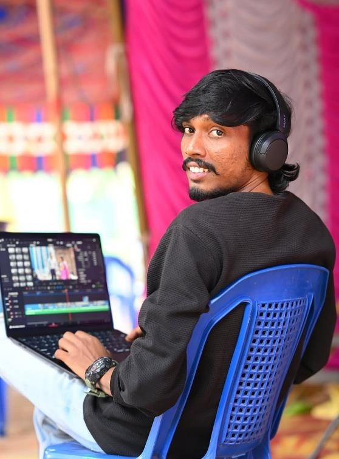

# MEESALA DEVADAS — Immersive 3D Creative Portfolio

> **"Every Frame Has a Story. I Bring It to Life."**

A world-class, production-ready 3D personal creative portfolio website for **MEESALA DEVADAS** — Creative Video Editor, Cinematographer, and Visual Storyteller based in Hyderabad & Nidadavole.



---

## 🌟 Key Highlights & Architecture

### 1. 3D WebGL "Designed in Glass" Hero
- Built with **Three.js 0.169.0**, PMREM `RoomEnvironment`, and custom GLSL shader injections (`onBeforeCompile`).
- **Thick Smoked-Glass Shards**: Rounded extruded polygon shards floating on a deep obsidian field (`#050507`), with iridescence, clearcoat roughness, and studio lighting.
- **Dynamic Mouse Tilt & Hover**: The whole glass slab tilts toward the cursor; hovered shards spring upward with real-time physics and tilt toward light.
- **Cursor Glow**: Soft lavender emission (`vec3(0.42, 0.37, 0.62)`) tracking pointer coordinates.
- **Printed Content & Hero Portrait**: High-DPR canvas projection mapping text, typography, and Devadas's portrait directly onto the glass shards.
- **Shatter Universe Interaction**: Clicking "Shatter Page →" shatters the glass shards into 3D space with tumble physics, revealing the *5 Principles of Real-Time Cinema*, complete with the 3D "← Back" sliver that reassembles the slab with ease-out-back physics.
- **Floating Film Elements**: 3D camera aperture ring, film sprockets, and warm floating embers in deep space.

### 2. Creative Capabilities & 3D Interactive Skills
- **Video Editing**: Timeline pacing, rhythmic beat-matching, narrative arcs, and dynamic cutting.
- **Cinematography**: Composition, anamorphic framing, rim lighting, and gimbal blocking.
- **Color Grading**: Node-based DaVinci Resolve color science, LUT creation, and skin-tone isolation.
- **Audio & Sound Design**: Foley effects, noise suppression, dialogue leveling, and atmospheric sound beds.
- **Creative Screenwriting**: Story conception, screenplay formatting, and visual storyboard layout.
- **Social & Viral Content**: 9:16 vertical retention editing, kinetic captions, and creator collaborations.

### 3. Post-Production Software Suite
- **DaVinci Resolve Studio** (Advanced / Primary)
- **Adobe Premiere Pro** (Advanced / Primary)
- **CapCut Pro** (Master / Primary)
- **Adobe After Effects** (Motion Graphics & VFX)
- **Adobe Photoshop** (Thumbnail Art & Graphics)
- **Adobe Audition / Fairlight** (Spectral Sound Engineering)

### 4. Verified Selected Works Showcase
Direct integration of verified portfolio projects with inline Google Drive modal player & external links:
1. **COVER SONG — Melodic Visual Odyssey** (Music Video Production)
2. **THAR 4X4 — High-Octane Commercial** (Automotive Commercial & Foley Design)
3. **HONEY IS THE BEST — Narrative Short Film** (Comedic Timing & Creator Collaboration)
4. **CHINTU WEDS SANJU — Cinematic Wedding Teaser** (Emotional Storytelling & Warm Tone Mapping)
5. **ANAMORPHIC DREAMS — Cinematography Reel** (Low-Light Framing & Lens Flare Art)
6. **RESTART ACADEMY SHOWCASE — Promotional Film** (Documentary Pacing & Community Outreach)

### 5. Career & Education Timeline
- **Restart Academy, Hyderabad**: Video Editor & Post-Production Specialist
- **Devadas Creative Studio**: Independent Cinematographer & Freelance Editor
- **Restart Academy Film Studies**: Advanced film editing techniques, cinematography, lighting theory, and screenwriting.

### 6. Personal Branding & Contact
- **Instagram**: [@editor_of_nidadavole](https://www.instagram.com/editor_of_nidadavole?igsh=NHRkbmFxeGtnMXA1)
- **Direct Phone**: `+91 63029 98003`
- **Email**: `meesaladevadas77@gmail.com`
- **WhatsApp**: Direct chat integration
- **Operating Bases**: Hyderabad / Nidadavole, India

---

## 🛠️ Technology Stack

- **Framework**: Next.js 15 (App Router)
- **Language**: TypeScript
- **Styling**: Tailwind CSS
- **3D Engine**: Three.js 0.169.0 + RoomEnvironment
- **Animation & Physics**: Framer Motion, Spring Dynamics, Canvas Confetti
- **Icons**: Lucide React
- **Typography**: Sora (Display) + Inter (Body)
- **Hosting**: Vercel
- **Repository**: [gopalakrishnaeerothu-sudo/DEVADAS-PORTFOLIO](https://github.com/gopalakrishnaeerothu-sudo/DEVADAS-PORTFOLIO)

---

## 🚀 Getting Started

```bash
# Clone the repository
git clone https://github.com/gopalakrishnaeerothu-sudo/DEVADAS-PORTFOLIO.git

# Navigate into folder
cd DEVADAS-PORTFOLIO

# Install dependencies
npm install

# Start local dev server
npm run dev
```

Open [http://localhost:3000](http://localhost:3000) with your browser to experience the site.
